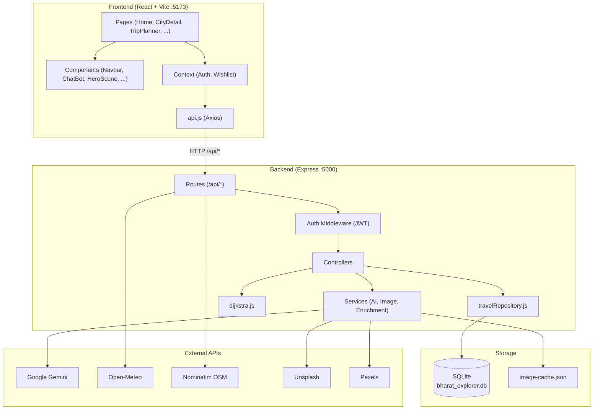

# BRAIN.md

> **Last verified:** 2026-09-11  
> **Application root:** `bharat-explorer/bharat-explorer/` (the workspace root contains only an empty `package-lock.json`; all source code lives in the nested app directory)

---

## 1. Project Overview

| Field | Value |
|---|---|
| **Project name** | Bharat Explorer (`bharat-explorer`) |
| **Purpose** | AI-powered smart travel platform for exploring India — cities, tourist places, hotels, food, trip planning, bookings, and reviews |
| **Main problem it solves** | Helps travelers discover, plan, and book trips across India in one place, with curated destination data, route optimization, weather, and AI-assisted recommendations |
| **Target users** | Travelers exploring India; college demo / portfolio audience (per `package.json` description); admins managing catalog content |
| **Current project status** | Functional full-stack demo with seeded data (28 cities). No automated tests. Some features incomplete (see Known Gaps). Suitable for local development and portfolio showcase. |
| **Main technologies** | React 18, Vite 5, Tailwind CSS 3, Express 4, Node.js built-in SQLite (`node:sqlite`), JWT, bcryptjs, Google Gemini AI, Three.js |
| **Important external services** | Google Gemini (`@google/generative-ai`), Open-Meteo (weather), Nominatim/OpenStreetMap (reverse geocoding), Unsplash API (optional), Pexels API (optional), Pixabay CDN (seed video URLs), Wikimedia/Unsplash (seed images) |

### Version & Scripts

| Package | Version | Key scripts |
|---|---|---|
| Root (`bharat-explorer/`) | 1.0.0 | `npm run dev` — runs client + server concurrently; `npm start` — production start |
| Client (`client/`) | 1.0.0 | `npm run dev` (port 5173), `npm run build`, `npm run preview` |
| Server (`server/`) | 1.0.0 | `npm start`, `npm run dev` (nodemon), `npm run seed` |

---

## 2. Architecture Overview

Bharat Explorer is a **monorepo-style full-stack web application** with a React SPA frontend and an Express REST API backend. The two processes run separately in development (client on `:5173`, server on `:5000`) and communicate via HTTP. Vite proxies `/api` requests to the backend.

### High-Level Architecture

```
Browser (React SPA)
    │
    │  HTTP /api/*  (Vite proxy in dev)
    ▼
Express API Server
    │
    ├── Controllers  →  business logic, request/response
    ├── Services     →  AI, images, city enrichment
    ├── Repository   →  all SQLite data access (travelRepository.js)
    ├── Middleware   →  JWT auth (protect, adminOnly)
    └── Algorithms   →  Dijkstra / nearest-neighbour route optimization
    │
    ▼
SQLite Database (bharat_explorer.db)
    │
    └── File cache (server/cache/image-cache.json)
```

### Application Layers

| Layer | Location | Responsibility |
|---|---|---|
| **Presentation** | `client/src/pages/`, `client/src/components/` | UI, routing, user interaction |
| **Client state** | `client/src/context/` | Auth (JWT in localStorage), wishlist sync |
| **API client** | `client/src/services/api.js` | Axios instance with auth header injection |
| **HTTP / routing** | `server/routes/`, `server/app.js` | REST endpoints, CORS, error handling |
| **Controllers** | `server/controllers/` | Request validation, orchestration |
| **Services** | `server/services/` | External API calls (Gemini, Unsplash, Pexels), image caching |
| **Data access** | `server/repositories/travelRepository.js` | Raw SQL queries, entity shaping |
| **Database** | `server/config/database.js` | Schema creation, migrations, row mappers |
| **Seed data** | `server/data/` | Initial cities, places, hotels, foods |

### Frontend Architecture

- **Framework:** React 18 with Vite and ES modules
- **Routing:** `react-router-dom` v6 — 13 routes defined in `App.jsx`
- **Styling:** Tailwind CSS with a dark luxury theme (`bg-[#090d14]`, gold accents); fonts: Playfair Display, Poppins, Inter (loaded in `index.html`)
- **State management:** React Context only — no Redux/Zustand
  - `AuthContext` — login/register/logout, token hydration via `/api/auth/me`
  - `WishlistContext` — server-synced wishlist for authenticated users
- **Notifications:** `react-hot-toast`
- **3D graphics:** Three.js in `HeroScene.jsx` (home page globe)
- **Global UI:** `Navbar`, `Footer`, floating `ChatBot` (Gemini-powered) on every page
- **Build output:** `client/dist/` (production bundle)

### Backend Architecture

- **Entry:** `server.js` → loads `app.js`, listens on `PORT` (default `5000`)
- **Pattern:** Classic Express MVC-ish — routes → controllers → repository
- **No ORM:** Direct SQL via Node.js built-in `DatabaseSync` (`node:sqlite`)
- **No separate models folder:** Entity shapes defined as mapper functions in `database.js` (`cityShape`, `placeShape`, etc.)
- **Auto-seed:** On startup, if no cities exist, `seedData.js` runs automatically
- **Error handling:** Global 500 handler in `app.js`

### Database Architecture

- **Engine:** SQLite (file-based, no external DB server required)
- **File:** `server/database/bharat_explorer.db` (configurable via `SQLITE_DB_PATH`)
- **Initialization:** `initDatabase()` in `config/database.js` — creates 10 tables with foreign keys
- **Tables:** `users`, `cities`, `tourist_places`, `hotels`, `food_places`, `wishlist`, `reviews`, `visual_content`, `trip_planner`, `bookings`
- **Migrations:** Inline `ALTER TABLE` attempts for `bookings` payment columns (idempotent)
- **Seeded data:** 28 Indian cities with associated places, hotels, and food items from `sampleData.js`

### Authentication / Authorization

| Aspect | Implementation |
|---|---|
| **Registration** | `POST /api/auth/register` — bcrypt password hash, returns JWT |
| **Login** | `POST /api/auth/login` — verifies hash, returns JWT |
| **Token** | JWT signed with `JWT_SECRET`, 7-day expiry (**Needs Verification** — confirm expiry in `authController.js`) |
| **Storage (client)** | `localStorage` key `be_token` |
| **Protected routes** | `protect` middleware — validates Bearer token, attaches `req.user` |
| **Admin routes** | `adminOnly` middleware — requires `role === 'admin'` |
| **Default admin** | `admin@bharat.com` / `admin123` (seeded) |

**Protected API areas:** wishlist, reviews (write), bookings, admin CRUD  
**Protected pages:** wishlist, my-bookings, profile, admin (client-side gating — **Needs Verification** for route guards)

### External Services

| Service | Used by | API key required? |
|---|---|---|
| Google Gemini | `aiService.js` → `/api/ai/plan`, `/api/ai/chat` | Yes (`GEMINI_API_KEY`); falls back to rule-based replies if missing |
| Open-Meteo | `weatherRoutes.js` | No |
| Nominatim (OSM) | `weatherRoutes.js` (reverse geocoding) | No |
| Unsplash | `imageService.js` | Optional (`UNSPLASH_ACCESS_KEY`) |
| Pexels | `imageService.js` | Optional (`PEXELS_API_KEY`) |
| Web Speech API | `ChatBot.jsx` | No (browser-native) |
| Instagram embed.js | `index.html` | No |

### Background Jobs / Workers

**None.** All processing is synchronous/request-scoped. No job queue, cron, or worker process.

### Storage

| Type | Location | Purpose |
|---|---|---|
| **Primary database** | `server/database/bharat_explorer.db` | All application data |
| **Image URL cache** | `server/cache/image-cache.json` | 14-day TTL cache for Unsplash/Pexels lookups |
| **Client localStorage** | Browser | JWT token (`be_token`), ChatBot conversation memory (**Needs Verification**) |
| **Static assets** | `client/public/`, `client/dist/` | Fallback SVG, production build |
| **Uploaded files** | **None** — `multer` is listed in dependencies but not used anywhere in server source |

### Caching

- **Image service:** JSON file cache (`image-cache.json`) with 14-day TTL; curated Unsplash fallback images per entity type (city, place, hotel, food)
- **No Redis, no HTTP cache headers** — API responses are uncached
- **No client-side data cache** beyond React state and localStorage token

### Notifications

- **In-app toasts:** `react-hot-toast` for success/error feedback
- **Email / SMS / push:** **Not implemented**
- **Server-side notifications:** **Not implemented**

### Third-Party Integrations

1. **Dual trip-planning systems** (intentional overlap):
   - **Rule-based:** `/api/trip/plan` + `/api/trip/chat` — used by `TripPlanner.jsx`
   - **Gemini AI:** `/api/ai/plan` + `/api/ai/chat` — used by `ChatBot.jsx`
2. **Route optimization:** Nearest-neighbour algorithm using Haversine distance (`algorithms/dijkstra.js`) for `/api/places/route/:cityId`
3. **City enrichment:** On-demand travel guide enrichment via `cityEnrichmentService.js` + `richCityRecommendations.js`
4. **Visual content:** Video/panorama URLs stored in `visual_content` table; Pixabay URLs in seed data
5. **Payment simulation:** Bookings store `payment_method`, `payment_status`, `transaction_id` — no real payment gateway integration

### Mermaid Architecture Diagram



### Known Gaps

| Issue | Status |
|---|---|
| `GET /api/user/dashboard` — controller exists (`userController.js`) but route is **not mounted** in `app.js`; `Profile.jsx` will 404 | Broken |
| `VisualExperience.jsx` hardcodes `http://localhost:5000` instead of relative `/api` proxy | Bug |
| `WEATHER_API_KEY` in `.env` is unused (Open-Meteo needs no key) | Dead config |
| No `.env.example` file | Missing |
| No `.gitignore` found in workspace | **Needs Verification** — secrets may be at risk |
| No automated tests | Missing |
| `multer` dependency unused | Dead dependency |

---

## 3. Project Directory Structure

```
bharat-explorerrrrrr/                          # Workspace root
├── BRAIN.md                                   # This file — project knowledge base
├── package-lock.json                          # Empty lockfile (no root package.json)
│
└── bharat-explorer/
    └── bharat-explorer/                       # ★ APPLICATION ROOT — run all commands here
        ├── package.json                       # Root scripts (dev, start via concurrently)
        ├── package-lock.json
        ├── dev-server.out.log                 # Runtime log output
        │
        ├── client/                            # React frontend
        │   ├── package.json
        │   ├── vite.config.js                 # Dev server :5173, /api proxy → :5000
        │   ├── tailwind.config.js
        │   ├── postcss.config.js
        │   ├── index.html                     # HTML shell, fonts, Instagram embed
        │   ├── public/
        │   │   └── fallback-travel.svg        # Fallback image asset
        │   ├── dist/                          # Production build output (generated)
        │   └── src/
        │       ├── main.jsx                   # React entry point
        │       ├── App.jsx                    # Router, providers, layout
        │       ├── index.css                  # Tailwind imports + global styles
        │       ├── components/                # Reusable UI components (14 files)
        │       ├── context/                   # AuthContext, WishlistContext
        │       ├── pages/                     # Route-level page components (12 + admin/)
        │       └── services/
        │           └── api.js                 # Axios client with JWT interceptor
        │
        └── server/                            # Express backend
            ├── package.json
            ├── server.js                      # HTTP server entry (listens on PORT)
            ├── app.js                         # Express app, middleware, route mounting
            ├── .env                           # Environment variables (secrets — do not commit)
            ├── README.md                      # Server-specific setup docs
            ├── algorithms/
            │   └── dijkstra.js                # Haversine distance + route optimization
            ├── cache/
            │   └── image-cache.json           # Runtime image URL cache (auto-generated)
            ├── config/
            │   └── database.js                # SQLite schema, init, entity mappers
            ├── controllers/                   # Request handlers (11 files)
            ├── data/
            │   ├── seedData.js                # Database seeding script
            │   ├── sampleData.js              # 28 cities + places/hotels/foods
            │   └── richCityRecommendations.js # City guide enrichment content
            ├── database/
            │   └── bharat_explorer.db         # SQLite DB file (created on first run)
            ├── middleware/
            │   └── authMiddleware.js          # JWT protect + adminOnly
            ├── repositories/
            │   └── travelRepository.js        # All SQL queries and data access
            ├── routes/                        # Express route definitions (15 files)
            └── services/
                ├── aiService.js               # Google Gemini integration
                ├── imageService.js            # Image search + file cache
                └── cityEnrichmentService.js   # On-demand city guide enrichment
```

### Directory Responsibilities

#### `client/src/components/`
- **Contains:** Reusable UI pieces — cards, navbar, footer, modals, widgets, ChatBot, Three.js hero
- **Responsibility:** Presentational and lightly interactive components shared across pages
- **Place here:** New shared UI elements used by 2+ pages
- **Do not place:** Page-specific layouts, API calls (use pages or services), route definitions

#### `client/src/pages/`
- **Contains:** One component per route — `Home.jsx`, `CityDetail.jsx`, `admin/AdminDashboard.jsx`, etc.
- **Responsibility:** Page-level data fetching, layout composition, route-specific logic
- **Place here:** New top-level views; add corresponding route in `App.jsx`
- **Do not place:** Generic reusable widgets (use `components/`)

#### `client/src/context/`
- **Contains:** `AuthContext.jsx`, `WishlistContext.jsx`
- **Responsibility:** Global client state shared across the component tree
- **Place here:** New cross-cutting client state that multiple pages need
- **Do not place:** Local component state, server-side logic

#### `client/src/services/`
- **Contains:** `api.js` (Axios wrapper)
- **Responsibility:** HTTP client configuration, auth header injection
- **Place here:** New API client utilities or shared fetch helpers
- **Do not place:** React components, business logic that belongs on the server

#### `server/routes/`
- **Contains:** Express `Router` instances — one file per resource (`authRoutes.js`, `cityRoutes.js`, etc.)
- **Responsibility:** URL mapping to controller functions, middleware attachment
- **Place here:** New API endpoint groups; mount in `app.js`
- **Do not place:** Business logic (use controllers), SQL queries (use repository)

#### `server/controllers/`
- **Contains:** 11 controller files — `authController.js`, `cityController.js`, `bookingController.js`, etc.
- **Responsibility:** Parse requests, call repository/services, format responses
- **Place here:** New endpoint handler functions
- **Do not place:** Raw SQL, route definitions

#### `server/services/`
- **Contains:** `aiService.js`, `imageService.js`, `cityEnrichmentService.js`
- **Responsibility:** External API integration, complex business logic, caching
- **Place here:** New third-party integrations, algorithms that don't fit in controllers
- **Do not place:** HTTP request/response handling, direct route mounting

#### `server/repositories/`
- **Contains:** `travelRepository.js` (single file — all DB access)
- **Responsibility:** SQL queries, data shaping, CRUD for all entities
- **Place here:** New database queries and data access methods
- **Do not place:** HTTP logic, external API calls

#### `server/config/`
- **Contains:** `database.js`
- **Responsibility:** Database connection, schema creation, row-to-object mappers
- **Place here:** Schema changes, new table definitions, migration logic
- **Do not place:** Query logic (use repository), environment-specific app config

#### `server/data/`
- **Contains:** `seedData.js`, `sampleData.js`, `richCityRecommendations.js`
- **Responsibility:** Static seed content, seeding scripts
- **Place here:** New seed data, enrichment content files
- **Do not place:** Runtime logic, API handlers

#### `server/middleware/`
- **Contains:** `authMiddleware.js`
- **Responsibility:** Cross-cutting request processing (auth, authorization)
- **Place here:** New middleware (rate limiting, logging, validation)
- **Do not place:** Business logic, route definitions

#### `server/algorithms/`
- **Contains:** `dijkstra.js`
- **Responsibility:** Pure algorithmic functions (route optimization)
- **Place here:** New computational/algorithm modules with no side effects
- **Do not place:** Database access, HTTP handling

#### `server/cache/`
- **Contains:** `image-cache.json` (auto-generated at runtime)
- **Responsibility:** File-based cache for image service
- **Place here:** Nothing manually — managed by `imageService.js`
- **Do not place:** Source code, committed secrets

#### `server/database/`
- **Contains:** `bharat_explorer.db` (auto-generated)
- **Responsibility:** SQLite database file storage
- **Place here:** Nothing manually — created by `initDatabase()`
- **Do not place:** Schema definitions (use `config/database.js`), seed scripts

### Environment Variables

Defined in `server/.env` (no `.env.example` exists):

| Variable | Required | Default | Purpose |
|---|---|---|---|
| `PORT` | No | `5000` | Server listen port |
| `JWT_SECRET` | No | `bharat-demo-secret` | JWT signing key |
| `NODE_ENV` | No | — | Environment mode |
| `GEMINI_API_KEY` | For AI features | — | Google Gemini API access |
| `AI_MODEL` | No | `gemini-2.5-flash` | Gemini model name |
| `SQLITE_DB_PATH` | No | `server/database/bharat_explorer.db` | Database file path |
| `UNSPLASH_ACCESS_KEY` | No | — | HD image search |
| `PEXELS_API_KEY` | No | — | Image search fallback |
| `WEATHER_API_KEY` | **Unused** | — | Not referenced in code; weather uses Open-Meteo |

### API Route Map (Quick Reference)

| Prefix | Route file | Auth |
|---|---|---|
| `/api/auth` | `authRoutes.js` | Mixed |
| `/api/cities` | `cityRoutes.js` | Admin for write |
| `/api/places` | `placeRoutes.js` | Admin for write |
| `/api/hotels` | `hotelRoutes.js` | Admin for write |
| `/api/food` | `foodRoutes.js` | Admin for write |
| `/api/search` | `searchRoutes.js` | Public |
| `/api/wishlist` | `wishlistRoutes.js` | Protected |
| `/api/reviews` | `reviewRoutes.js` | Mixed |
| `/api/admin` | `adminRoutes.js` | Admin |
| `/api/trip` | `tripRoutes.js` | Public |
| `/api/bookings` | `bookingRoutes.js` | Mixed |
| `/api/weather` | `weatherRoutes.js` | Public |
| `/api/visual` | `visualRoutes.js` | Public (write unprotected) |
| `/api/ai` | `aiRoutes.js` | Public |
| `/api/images` | `imageRoutes.js` | Public |
| `/api/health` | inline in `app.js` | Public |
| `/api/user` | **Not mounted** | — |

### Frontend Route Map

| Path | Page component |
|---|---|
| `/` | `Home.jsx` |
| `/city/:id` | `CityDetail.jsx` |
| `/place/:id` | `PlaceDetail.jsx` |
| `/hotel/:id` | `HotelDetail.jsx` |
| `/food/:id` | `FoodDetail.jsx` |
| `/search` | `Search.jsx` |
| `/login` | `Login.jsx` |
| `/register` | `Register.jsx` |
| `/wishlist` | `Wishlist.jsx` |
| `/trip-planner` | `TripPlanner.jsx` |
| `/admin` | `admin/AdminDashboard.jsx` |
| `/my-bookings` | `MyBookings.jsx` |
| `/profile` | `Profile.jsx` |

### Getting Started

```bash
# From application root: bharat-explorer/bharat-explorer/
cd bharat-explorer/bharat-explorer

# Install all dependencies
npm install --prefix server
npm install --prefix client
npm install

# Configure environment
# Copy server/.env and set GEMINI_API_KEY (optional, for AI features)

# Run development (client :5173 + server :5000)
npm run dev

# Seed / reset database manually
npm run seed --prefix server
```

**Health check:** `GET http://localhost:5000/api/health`  
**Demo admin:** `admin@bharat.com` / `admin123`
